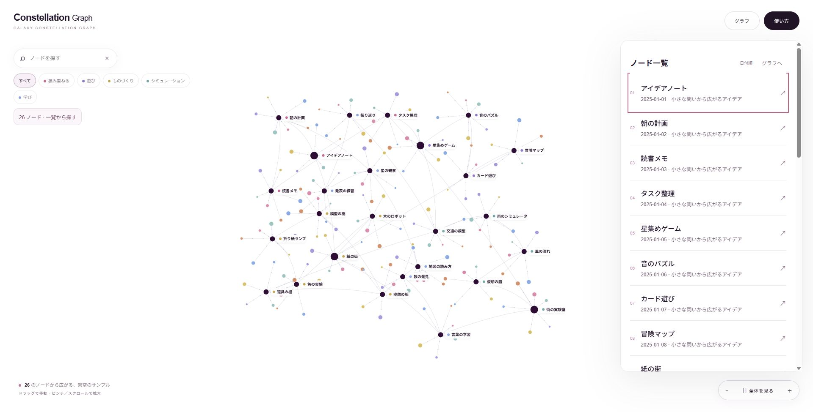
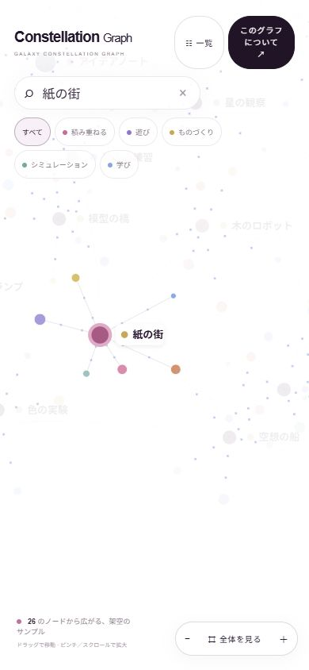

<div align="center">


# Galaxy Constellation Graph

ノード・つながり・メモを、星座のように探索するグラフ可視化ツール。

[](https://github.com/Sunwood-ai-labs/galaxy-constellation-graph/actions/workflows/check.yml)

[English](README.md) · **日本語**

[公開デモ](https://sunwood-ai-labs.github.io/galaxy-constellation-graph/) · [操作ガイド](docs/guide.md) · [データ形式](docs/data-format.md)

</div>

白いキャンバス上でノードと辺、関連メモを探索する軽量アプリです。HTML / CSS / JavaScript / SVG のみで動き、パッケージ導入、APIキー、外部API、ビルドは不要です。アプリのUIは日本語、説明は日英対応です。

## ✨ 機能
- タイトル・説明・メモを検索し、カテゴリと組み合わせて絞り込み
- グラフと読みやすい一覧を切り替え、詳細・関連ノードへ移動
- ドラッグ、拡大縮小、全体表示、キーボード操作
- スマホ幅では一覧から始め、必要に応じてグラフへ切り替え

天文学シミュレーター、力学自動配置エンジン、大規模グラフDBではありません。26ノード・156メモはすべて架空です。26ノードまでは固定座標、それ以降は決定的な螺旋配置です。入力上限は500ノードです。

## 🖼 スクリーンショット
架空データの実ブラウザ画面です。生成モックではありません。



<details>
<summary>スマホの実画面</summary>

</details>

## 🚀 起動
Python 3を導入し、リポジトリのフォルダーで実行します。

```sh
python -m http.server 8000
```

<http://localhost:8000> を開きます。uv利用時は `uv run --no-project python -m http.server 8000` も利用できます。JSONの取得にHTTPが必要なので、index.htmlの直接ダブルクリックは使わないでください。他端末に公開しない場合は `--bind 127.0.0.1` を追加します。

## 🧭 使い方とカスタマイズ
- [操作・キーボード・困ったとき](docs/guide.md)
- [データ形式・制約](docs/data-format.md)
- [配布・検証・公開前チェック](docs/deployment.md)
- [検証実績と未検証環境](QA.md)
- [開発参加](CONTRIBUTING.md) · [セキュリティ](SECURITY.md) · [変更履歴](CHANGELOG.md)

`data.json` のnodes/edgesを編集します。公開時は個人情報・秘密を含めないでください。カテゴリの名称と色は `app.js` で設定します。

## 🧪 検証
CIと同じ環境はNode.js 22、Python 3.12です。基本検査にはnpm依存は不要です。実ブラウザ検査には固定版Playwrightを使います。

```sh
node tests/check.cjs
```

Browser regression (Chromium + WebKit, not physical phones):
```sh
npm ci
npx playwright install chromium webkit
npm run test:browser
```

構文、架空データ、データ処理、操作回帰、文書リンクを一括検証します。失敗時は終了コードが0以外になります。mock DOMテストは実機や支援技術の動作保証ではありません。

## 📁 構成
| パス | 役割 |
| --- | --- |
| `index.html`, `style.css` | 操作部品・レイアウト |
| `app.js`, `graph-data.js` | 操作・データ正規化 |
| `data.json` | 架空のデモデータ |
| `assets/` | 実画面スクショとアイコン |
| `docs/`, `tests/` | ガイドと検証 |

## 🔒 プライバシーと制限
認証・解析タグ・外部APIはありません。公開サンプルに元の私的会話、原画像、認証情報は含めていません。追加するリンク・画像は別途確認が必要で、HTTPSだけで安全や権利を保証できません。

Windows Chromeとレスポンシブ幅での検証範囲は [QA.md](QA.md) に記載しています。実機iPhone/Android、Safari、スクリーンリーダー、OSキーボードは未検証です。ピンチは合成イベントによる検証で、WCAG適合は主張しません。

## ⚖ ライセンス
所有者によるライセンス選択は未完了です。公開されていることだけを理由に、再配布・改変の包括的な許諾があるとは扱わないでください。勝手にライセンスや許諾を追加していません。
