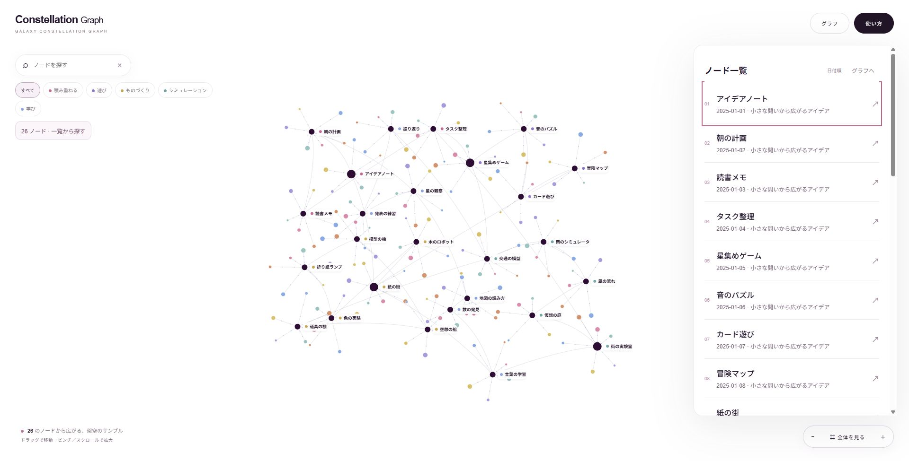
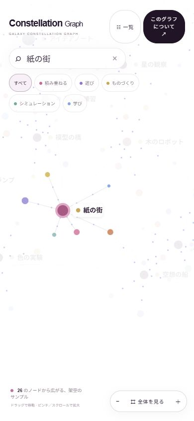

# Galaxy Constellation Graph

[公開デモを開く](https://sunwood-ai-labs.github.io/galaxy-constellation-graph/)

白いキャンバス上でノードと辺、関連メモを探索する軽量なグラフ可視化アプリです。HTML / CSS / JavaScript のみで動きます。

## スクリーンショット



公開版を実際にブラウザで起動した画面です。26ノード・156メモはすべて架空のサンプルです。

<details><summary>スマホの実画面</summary>



</details>

## 機能
- 検索、カテゴリ絞り込み、一覧表示
- ノードと関連データの詳細パネル
- ドラッグ移動、拡大縮小、全体表示
- キーボード操作とモバイル向けレイアウト

## 起動
```sh
python -m http.server 8000
```
http://localhost:8000 を開いてください。`fetch` を使うため、ファイルの直接ダブルクリックではなくHTTP経由で起動します。依存パッケージ、APIキー、外部APIは不要です。

## データ形式
`data.json` の `nodes` と `edges` を編集します。
- `nodes`: `id`（重複しない文字列または数値）、`title`、`sub`、`group`、`desc`、`date`、`img`、`quotes`（関連メモ配列）、`links`
- `quotes`: `id`、`date`、`text`、`author`。名称は元実装との互換性のため残しており、会話以外の説明や観察メモにも利用できます。
- `edges`: 接続するノードIDのペア
- `group`: SYSTEM / PLAY / MAKE / SIM / LEARN。ラベルや色は `app.js` の `G` で設定します。

サンプルの26ノードは手調整した座標です。27個目以降は決定的な螺旋配置になります。最大500ノードまで検証し、文字列ID・独自カテゴリも受け付けます。力学シミュレーションや大規模グラフ専用エンジンではありません。ノード数やラベル長によってはズーム・検索・一覧を使ってください。

## プライバシー
このリポジトリは公開用に新規作成した架空データのみを含みます。元の私的会話、識別子、画像、保存先URL、認証情報、元リポジトリ履歴は含めていません。個人データを追加したコピーを公開する際は、公開範囲を必ず確認してください。外部解析タグはありません。

## 検証
```sh
node --check app.js
python tests/validate.py
node tests/data.cjs
node tests/smoke.cjs
node tests/regression.cjs
```

## 操作とトラブルシューティング
- ドラッグで移動、ホイールまたはピンチで拡縮。「全体を見る」で配置全体に戻ります。
- 検索はタイトル・説明・メモが対象。カテゴリと組み合わせできます。一覧では日付順に切替できます。
- ノードは Enter / Space で開き、詳細は Escape で閉じます。詳細内の Tab はパネル内を移動します。
- 読込エラーが出たら HTTP サーバーの起動、data.json のJSON構文、IDの重複、辺の参照先を確認して再読み込みしてください。
- メモ・画像・リンク・日付は省略可。リンクはHTTPSのみ、画像はHTTPSまたは assets/ 配下の相対パスです。危険なURLは読み込み時に拒否します。

## 検証とCI
GitHub Actions は構文、サンプルの架空データ監査、データ正規化とURL制限、mock DOMでの主要操作を確認します。mockテストは実ブラウザの描画保証ではありません。PC/スマホの描画・操作は別途実ブラウザで確認しています。初期表示で全体にフィットします。

## デモ配信
ビルド不要です。このフォルダーを静的HTTPサーバーで配信できます。GitHub Pagesを使う場合は main の / (root) を配信元に指定してください。非公開データを置かないでください。このリポジトリでは GitHub Pages を main / (root) から公開済みです。

## ライセンス
現時点ではライセンス未指定です。公開されていることだけを理由に、再配布・改変の包括的な許諾があるとは扱わないでください。ライセンス選択は所有者の判断として保留しています。

## セキュリティ
認証・外部API・解析タグはありません。文字列は表示時にエスケープし、URLは許可方式で検証します。公開に適したデータかどうかを自動保証するものではありません。個人情報・秘密・権利のない素材は追加しないでください。
